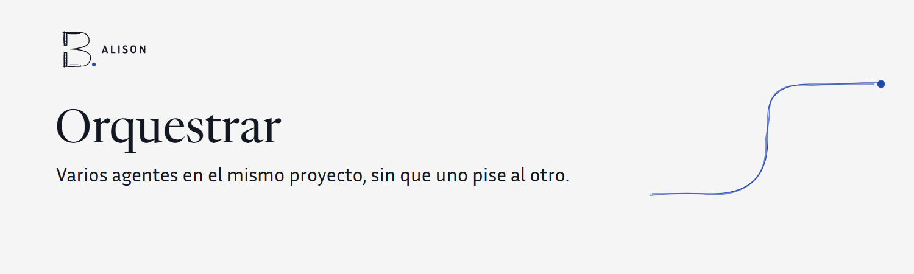
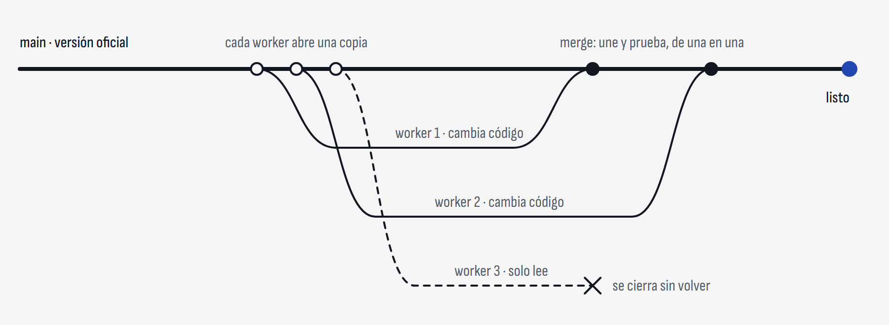
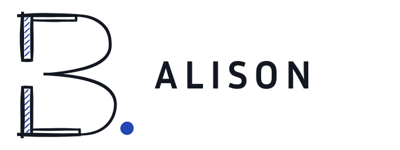

<picture>
  <source media="(prefers-color-scheme: dark)" srcset="assets/capa-es-escuro.png">
  
</picture>

<h1 align="center">Orquestrar</h1>

<p align="center">Ejecutar varios agentes de código a la vez suele terminar contigo uniendo su trabajo a mano. Con esta skill para <a href="https://orca.dev">Orca</a>, describes el trabajo una vez: un agente lo divide, cada worker programa en su propia copia del proyecto, y a <code>main</code> solo llega lo que pasó los tests.</p>

<p align="center">
  
  <a href="LICENSE"></a>
</p>

<p align="center">
  <a href="#cómo-empezar">Cómo empezar</a> &nbsp; / &nbsp;
  <a href="#demostración-y-funciones">Ver funciones</a> &nbsp; / &nbsp;
  <a href="#documentación-y-ayuda">Documentación</a> &nbsp; · &nbsp;
  <a href="README.md">English</a> &nbsp; · &nbsp;
  <a href="README.pt-BR.md">Português</a>
</p>

---

## Sobre el proyecto

Ejecutar agentes en paralelo se convierte en tu trabajo:

- Dos agentes tocan el mismo archivo y uno deshace lo que hizo el otro.
- Una búsqueda de una línea va al modelo más caro y gasta la cuota de la semana.
- Las worktrees siguen abiertas cuando el trabajo termina y se van acumulando.
- Al final, lees cada terminal, unes todo a mano y ejecutas los tests.

Orquestrar es una skill para [Orca](https://orca.dev), la app que ejecuta varios agentes de código en paralelo, cada uno en su worktree. El agente con el que hablas se vuelve el orquestador: pregunta, divide el trabajo, elige el modelo de cada tarea, revisa las pruebas e informa. No escribe código. Eso lo hacen los workers.

Qué cambia:

- **`main` solo recibe lo que pasó los tests.** Cada worker trabaja en su propia copia. Un worker de merge trae las copias de una en una y ejecuta los tests en cada paso.
- **Cada tarea va al modelo más barato que la resuelve.** Antes de cada lanzamiento, el orquestador comprueba en Orca qué herramientas están instaladas y cuánta cuota le queda a cada una. No necesitas saber el nombre de ningún modelo.
- **Solo decides lo que no tiene vuelta atrás.** Push, deploy, borrar, usar el nivel tope y añadir un modelo al catálogo esperan tu aprobación.

## Demostración y funciones

<p align="center">
  <picture>
    <source media="(prefers-color-scheme: dark)" srcset="assets/diagrama-es-escuro.png">
    
  </picture>
</p>

<sub>Diagrama del flujo. No es una captura de un uso real.</sub>

1. **Describes el trabajo.** El orquestador pregunta hasta saber qué cuenta como terminado y muestra la división en una tabla corta antes de empezar.
2. **Cada worker trabaja en su propia copia**, con el modelo más barato que resuelve la tarea. Tiene hasta 3 intentos. Si no alcanza, para y avisa.
3. **Un worker de merge lleva las copias a `main`** de una en una y ejecuta los tests en cada paso.
4. **Recibes el informe con pruebas:** qué quedó listo, qué quedó abierto y qué espera tu aprobación. Las copias se cierran.

| Tipo de tarea | Nivel | Esfuerzo |
| --- | --- | --- |
| Consulta, lectura, búsqueda, extracción | barato | low |
| Código puntual, ajuste pequeño, test rápido | barato | medium |
| Pantallas, interfaz, lectura de imágenes | intermedio | medium |
| Merge y batería de tests | intermedio | medium |
| Revisión y control de seguridad | intermedio | high |
| Investigación a fondo | intermedio | high |
| Código grande, migración, integración arriesgada | fuerte | high |
| Decisión ambigua, problema sin solución conocida | tope, con tu aprobación | high |

### Prueba

Este repositorio lo publicó la propia skill. El 19/11/2026, `/orquestrar` dividió el trabajo en workers en Orca, y los cuatro primeros pasos tardaron 6 minutos:

| Worker | Tarea | Modelo y esfuerzo | Qué pasó |
| --- | --- | --- | --- |
| montar | Copiar los archivos, poner la licencia, ajustar los enlaces | Claude Haiku 5.5 · medium | Listo. También encontró una comprobación errónea en las instrucciones del propio orquestador |
| revisar | Leer todo antes de hacerlo público, sin editar | Claude Sonnet 5.5 · high | Encontró un enlace roto a `catalogo.md` y el e-mail personal del autor en los commits |
| montar, 2.ª ronda | Corregir ambos | Claude Haiku 5.5 · medium | Enlace retirado y commits reescritos con la dirección anónima de GitHub |
| merge | Llevar la branch a `main` y ejecutar la comprobación del README en los tres idiomas | Gemini 4 Hydrogen (Antigravity) · medium | Las tres comprobaciones pasaron |
| prueba | Escribir esta sección | DeepSeek V4.1 Flash (OpenCode) | |

Un segundo worker de merge trajo esta sección a `main`, y un último worker publicó el repositorio. La cuota apenas se movió: Claude se quedó en el 6% de la semana y Antigravity en el 1%.

La ronda también cambió la skill. El orquestador mandó los primeros workers a un solo proveedor; el usuario lo notó, y la skill ahora pide repartir el trabajo entre los proveedores con cuota disponible.

## Cómo empezar

1. Instala [Orca](https://orca.dev) e inicia sesión en al menos una herramienta de agente.
2. Pon esta carpeta en la carpeta de skills de tu agente. En Claude Code:

   ```bash
   git clone https://github.com/ba-lison/orca_plugin_orquestrar ~/.claude/skills/orquestrar
   ```

3. Abre una conversación en el proyecto y llama a la skill:

   ```text
   /orquestrar
   ```

La primera vez, elige algo pequeño para ver el flujo completo. Sin catálogo, el orquestador investiga las herramientas y los modelos que tienes y te muestra el catálogo antes de guardarlo.

## Documentación y ayuda

| Tema | Dónde consultar |
| --- | --- |
| Reglas completas del orquestador y de los workers | [SKILL.md](SKILL.md) |
| Orca | [orca.dev](https://orca.dev) |
| Errores y sugerencias | [Issues](https://github.com/ba-lison/orca_plugin_orquestrar/issues) |

### Dudas

**¿Y si un worker se equivoca?** Tiene hasta 3 intentos en su propia copia. Si no lo resuelve, para, y el orquestador te trae el caso. `main` no se toca.

**¿Va a gastar mi cuota?** El orquestador empieza por el nivel más barato y comprueba la cuota de cada herramienta en Orca antes de lanzar. Una herramienta con la cuota semanal al 100% no recibe workers.

**¿Un worker puede salirse de lo acordado?** Cada tarea lleva las reglas por escrito: tocar solo los archivos permitidos, no llamar a otros agentes, hacer commit solo en su copia y nunca hacer push. Si tiene que decidir alcance, arquitectura o seguridad, pregunta antes.

**¿Funciona sin Orca?** No. La skill usa los comandos de orquestación de Orca para crear las copias, abrir los workers e intercambiar mensajes con ellos.

### Créditos y materiales de terceros

Orca es un proyecto de código abierto aparte ([stablyai/orca](https://github.com/stablyai/orca)). Orquestrar es independiente y no tiene vínculo ni respaldo de Orca.

## Autoría y licencia

Desarrollado por [Alison Cruz](https://github.com/ba-lison) · **BALISON**.

Distribuido bajo la [licencia MIT](LICENSE).

---

<p align="center">
  <picture>
    <source media="(prefers-color-scheme: dark)" srcset="assets/assinatura-escuro.svg">
    
  </picture>
  <br>
  <sub>Tecnología con trazo humano.</sub>
</p>
