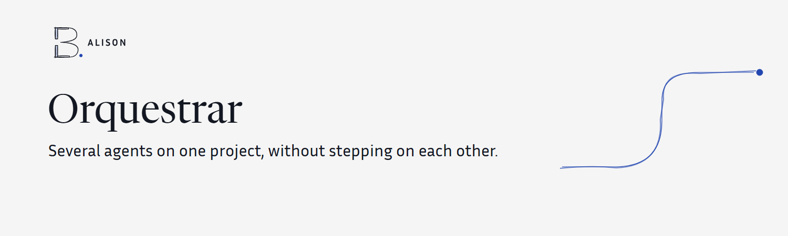
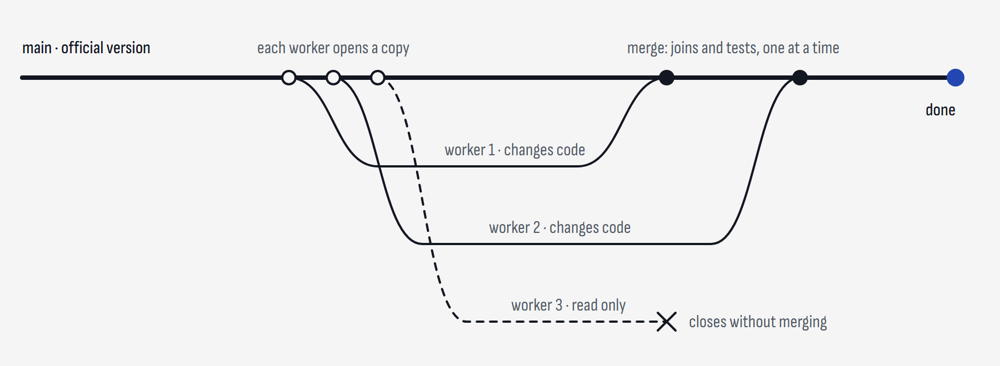
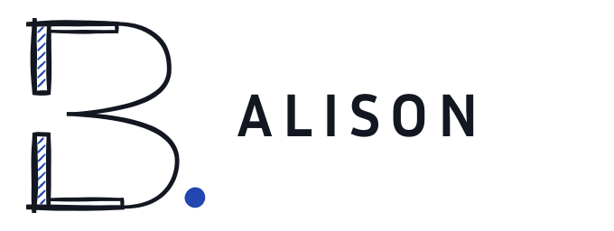

<picture>
  <source media="(prefers-color-scheme: dark)" srcset="assets/capa-en-escuro.png">
  
</picture>

<h1 align="center">Orquestrar</h1>

<p align="center">Running several coding agents at once usually ends with you merging their work by hand. With this <a href="https://orca.dev">Orca</a> skill, you describe the job once: one agent splits it, each worker codes in its own copy of the project, and only work that passed the tests reaches <code>main</code>.</p>

<p align="center">
  
  <a href="LICENSE"></a>
</p>

<p align="center">
  <a href="#getting-started">Get started</a> &nbsp; / &nbsp;
  <a href="#demo-and-features">See features</a> &nbsp; / &nbsp;
  <a href="#documentation-and-help">Documentation</a> &nbsp; · &nbsp;
  <a href="README.pt-BR.md">Português</a> &nbsp; · &nbsp;
  <a href="README.es.md">Español</a>
</p>

---

## About the project

Running agents in parallel turns into your job:

- Two agents edit the same file and one undoes the other's work.
- A one-line lookup goes to the most expensive model and eats the week's quota.
- Worktrees stay open after the work is done and keep piling up.
- In the end, you read every terminal, merge everything by hand and run the tests.

Orquestrar is a skill for [Orca](https://orca.dev), the app that runs several coding agents in parallel, each in its own worktree. The agent you talk to becomes the orchestrator: it asks, splits the work, picks a model for each task, checks the proof and reports back. It writes no code itself. The workers do that.

What changes:

- **`main` only receives what passed the tests.** Each worker works in its own copy. A merge worker brings the copies in one at a time and runs the tests after each one.
- **Each task goes to the cheapest model that solves it.** Before each launch, the orchestrator checks in Orca which tools are installed and how much quota each one has left. You don't need to know any model names.
- **You only decide what can't be undone.** Push, deploy, deleting, using the top tier and adding a model to the catalog wait for your approval.

## Demo and features

<p align="center">
  <picture>
    <source media="(prefers-color-scheme: dark)" srcset="assets/diagrama-en-escuro.png">
    
  </picture>
</p>

<sub>Diagram of the flow. It is not a screenshot of a real run.</sub>

1. **You describe the work.** The orchestrator asks until it knows what counts as done and shows the split in a short table before starting.
2. **Each worker works in its own copy**, with the cheapest model that can handle the task. It gets up to 3 attempts. If that is not enough, it stops and reports.
3. **A merge worker brings the copies into `main`** one at a time and runs the tests after each one.
4. **You get the report with proof:** what is done, what is still open and what needs your approval. The copies are closed.

| Task type | Tier | Effort |
| --- | --- | --- |
| Lookup, reading, search, extraction | cheap | low |
| Small code change, quick fix, quick test | cheap | medium |
| Screens, interface, reading images | mid | medium |
| Merge and test suite | mid | medium |
| Review and security check | mid | high |
| Deep research | mid | high |
| Large code, migration, risky integration | strong | high |
| Ambiguous decision, problem with no known solution | top, with your approval | high |

### Proof

[PENDING: first real job with `/orquestrar`. How many workers, how long, how much quota, what failed and how it was fixed.]

## Getting started

1. Install [Orca](https://orca.dev) and sign in to at least one agent tool.
2. Put this folder in your agent's skills folder. For Claude Code:

   ```bash
   git clone https://github.com/ba-lison/orca_plugin_orquestrar ~/.claude/skills/orquestrar
   ```

3. Open a conversation in your project and call the skill:

   ```text
   /orquestrar
   ```

The first time, pick something small so you can see the whole flow. With no catalog yet, the orchestrator researches the tools and models you have and shows you the catalog before saving it.

## Documentation and help

| Topic | Where to look |
| --- | --- |
| Full rules for the orchestrator and the workers | [SKILL.md](SKILL.md) |
| Orca | [orca.dev](https://orca.dev) |
| Bugs and suggestions | [Issues](https://github.com/ba-lison/orca_plugin_orquestrar/issues) |

### Questions

**What if a worker gets it wrong?** It gets up to 3 attempts in its own copy. If that is not enough, it stops and the orchestrator brings the case to you. `main` is not touched.

**Will it burn my quota?** The orchestrator starts with the cheapest tier and checks each tool's quota in Orca before launching. A tool at 100% of its weekly quota gets no workers.

**Can a worker go off script?** Every task carries the rules in writing: touch only the files it was given, call no other agents, commit only in its own copy and never push. If it needs to decide scope, architecture or security, it asks first.

**Does it work without Orca?** No. The skill uses Orca's orchestration commands to create the copies, open the workers and exchange messages with them.

### Credits and third-party materials

Orca is a separate open source project ([stablyai/orca](https://github.com/stablyai/orca)). Orquestrar is independent and has no affiliation with or endorsement from Orca.

## Author and license

Built by [Alison Cruz](https://github.com/ba-lison) · **BALISON**.

Distributed under the [MIT license](LICENSE).

---

<p align="center">
  <picture>
    <source media="(prefers-color-scheme: dark)" srcset="assets/assinatura-escuro.svg">
    
  </picture>
  <br>
  <sub>Technology with a human touch.</sub>
</p>
