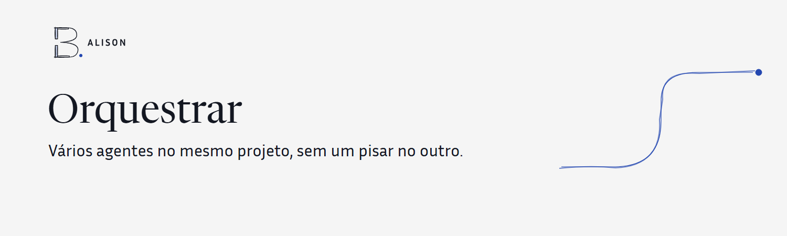
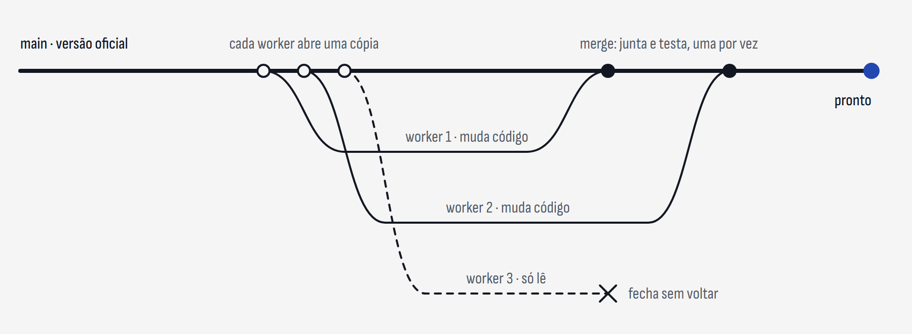
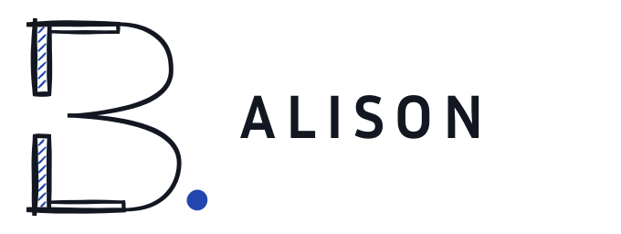

<picture>
  <source media="(prefers-color-scheme: dark)" srcset="assets/capa-pt-escuro.png">
  
</picture>

<h1 align="center">Orquestrar</h1>

<p align="center">Rodar vários agentes de código ao mesmo tempo costuma terminar com você juntando o trabalho deles à mão. Com esta skill para o <a href="https://orca.dev">Orca</a>, você descreve o trabalho uma vez: um agente divide, cada worker programa na própria cópia do projeto, e só chega à <code>main</code> o que passou nos testes.</p>

<p align="center">
  
  <a href="LICENSE"></a>
</p>

<p align="center">
  <a href="#começar-a-usar">Começar a usar</a> &nbsp; / &nbsp;
  <a href="#demonstração-e-recursos">Ver recursos</a> &nbsp; / &nbsp;
  <a href="#documentação-e-ajuda">Documentação</a> &nbsp; · &nbsp;
  <a href="README.md">English</a> &nbsp; · &nbsp;
  <a href="README.es.md">Español</a>
</p>

---

## Sobre o projeto

Rodar agentes em paralelo vira trabalho seu:

- Dois agentes mexem no mesmo arquivo e um desfaz o que o outro fez.
- Uma busca de uma linha vai para o modelo mais caro e gasta a cota da semana.
- As worktrees continuam abertas depois que o trabalho acaba e vão se acumulando.
- No fim, você lê cada terminal, junta tudo à mão e roda os testes.

O Orquestrar é uma skill para o [Orca](https://orca.dev), o app que roda vários agentes de código em paralelo, cada um na sua worktree. O agente com quem você conversa vira o orquestrador: pergunta, divide o trabalho, escolhe o modelo de cada tarefa, confere as provas e relata. Ele não escreve código. Quem escreve são os workers.

O que muda:

- **A `main` só recebe o que passou nos testes.** Cada worker trabalha na própria cópia. Um worker de merge traz as cópias uma por vez e roda os testes a cada passo.
- **Cada tarefa vai para o modelo mais barato que resolve.** Antes de cada disparo, o orquestrador confere no Orca quais ferramentas estão instaladas e quanto de cota cada uma ainda tem. Você não precisa saber o nome de nenhum modelo.
- **Você só decide o que não tem volta.** Push, deploy, apagar, usar a faixa topo e pôr um modelo novo no catálogo esperam o seu sim.

## Demonstração e recursos

<p align="center">
  <picture>
    <source media="(prefers-color-scheme: dark)" srcset="assets/diagrama-pt-escuro.png">
    
  </picture>
</p>

<sub>Diagrama do fluxo. Não é captura de um uso real.</sub>

1. **Você descreve o trabalho.** O orquestrador pergunta até saber o que conta como pronto e mostra a divisão numa tabela curta antes de começar.
2. **Cada worker trabalha na própria cópia**, com o modelo mais barato que dá conta da tarefa. Ele tem até 3 tentativas. Se não der, para e avisa.
3. **Um worker de merge junta as cópias na `main`**, uma por vez, e roda os testes a cada passo.
4. **Você recebe o relato com prova:** o que ficou pronto, o que ficou aberto e o que espera o seu sim. As cópias são fechadas.

| Tipo de tarefa | Faixa | Esforço |
| --- | --- | --- |
| Consulta, leitura, busca, extração | barato | low |
| Código pontual, ajuste pequeno, teste rápido | barato | medium |
| Tela, interface, leitura de imagem | intermediário | medium |
| Merge e suíte de testes | intermediário | medium |
| Conferência e revisão de segurança | intermediário | high |
| Pesquisa profunda | intermediário | high |
| Código grande, migração, integração arriscada | forte | high |
| Decisão ambígua, problema sem solução conhecida | topo, com o seu sim | high |

### Prova

Este repositório foi publicado pela própria skill. Em 19/11/2026, o `/orquestrar` dividiu o trabalho em workers no Orca, e as quatro primeiras etapas levaram 6 minutos:

| Worker | Tarefa | Modelo e esforço | O que aconteceu |
| --- | --- | --- | --- |
| montar | Copiar os arquivos, pôr a licença, ajustar os links | Claude Haiku 5.5 · medium | Pronto. Também achou uma conferência errada nas instruções do próprio orquestrador |
| conferir | Ler tudo antes de ir a público, sem editar | Claude Sonnet 5.5 · high | Achou um link quebrado para `catalogo.md` e o e-mail pessoal do autor nos commits |
| montar, 2ª rodada | Corrigir os dois | Claude Haiku 5.5 · medium | Link retirado e commits reescritos com o endereço anônimo do GitHub |
| merge | Levar a branch para a `main` e rodar a conferência do README nos três idiomas | Gemini 4 Hydrogen (Antigravity) · medium | As três conferências passaram |
| prova | Escrever esta seção | DeepSeek V4.1 Flash (OpenCode) | |

Um segundo worker de merge trouxe esta seção para a `main`, e um último worker publicou o repositório. A cota quase não mexeu: o Claude ficou em 6% da semana e o Antigravity em 1%.

A rodada também mudou a skill. O orquestrador mandou os primeiros workers para um só provedor; o usuário percebeu, e a skill agora pede para distribuir o trabalho entre os provedores com cota sobrando.

## Começar a usar

1. Instale o [Orca](https://orca.dev) e faça login em pelo menos uma ferramenta de agente.
2. Coloque esta pasta na pasta de skills do seu agente. No Claude Code:

   ```bash
   git clone https://github.com/ba-lison/orca_plugin_orquestrar ~/.claude/skills/orquestrar
   ```

3. Abra uma conversa no projeto e chame a skill:

   ```text
   /orquestrar
   ```

Na primeira vez, escolha algo pequeno, para ver o fluxo inteiro. Sem catálogo, o orquestrador pesquisa as ferramentas e os modelos que você tem e mostra o catálogo antes de gravar.

## Documentação e ajuda

| Assunto | Onde consultar |
| --- | --- |
| Regras completas do orquestrador e dos workers | [SKILL.md](SKILL.md) |
| Orca | [orca.dev](https://orca.dev) |
| Erros e sugestões | [Issues](https://github.com/ba-lison/orca_plugin_orquestrar/issues) |

### Dúvidas

**E se um worker errar?** Ele tem até 3 tentativas na própria cópia. Se não resolver, para, e o orquestrador traz o caso para você. A `main` não é tocada.

**Vai gastar minha cota?** O orquestrador começa pela faixa mais barata e confere a cota de cada ferramenta no Orca antes de disparar. Ferramenta com a cota da semana em 100% não recebe worker.

**Um worker pode sair do combinado?** Cada tarefa leva as regras por escrito: mexer só nos arquivos liberados, não chamar outros agentes, fazer commit só na própria cópia e nunca dar push. Se precisar decidir escopo, arquitetura ou segurança, ele pergunta antes.

**Funciona sem o Orca?** Não. A skill usa os comandos de orquestração do Orca para criar as cópias, abrir os workers e trocar mensagens com eles.

### Créditos e materiais de terceiros

O Orca é um projeto de código aberto separado ([stablyai/orca](https://github.com/stablyai/orca)). O Orquestrar é independente e não tem vínculo nem endosso do Orca.

## Autoria e licença

Desenvolvido por [Alison Cruz](https://github.com/ba-lison) · **BALISON**.

Distribuído sob a [licença MIT](LICENSE).

---

<p align="center">
  <picture>
    <source media="(prefers-color-scheme: dark)" srcset="assets/assinatura-escuro.svg">
    
  </picture>
  <br>
  <sub>Tecnologia com traço humano.</sub>
</p>
